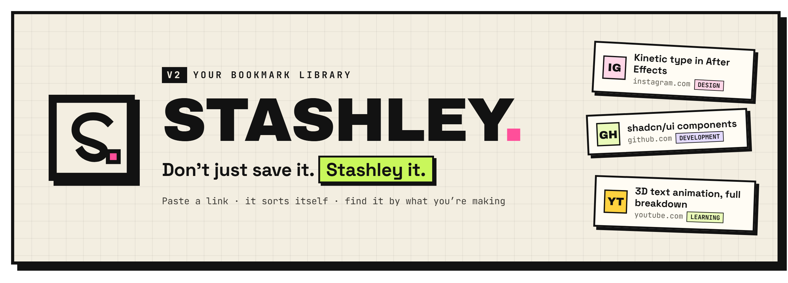
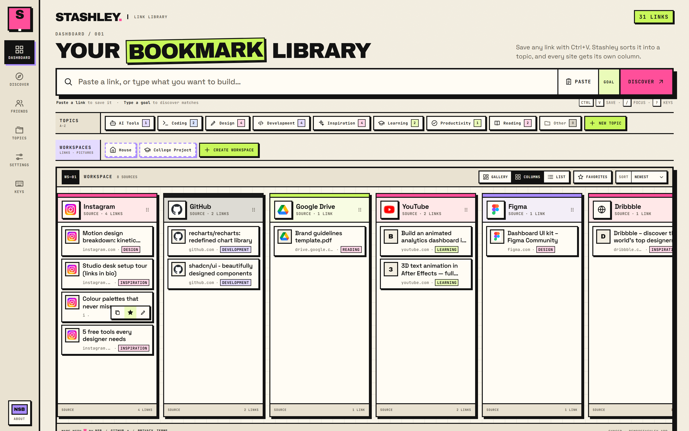
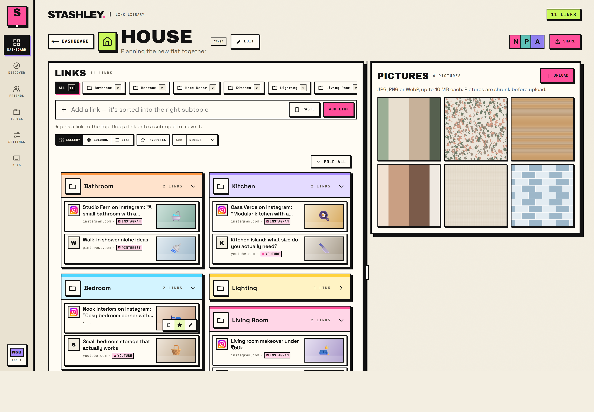
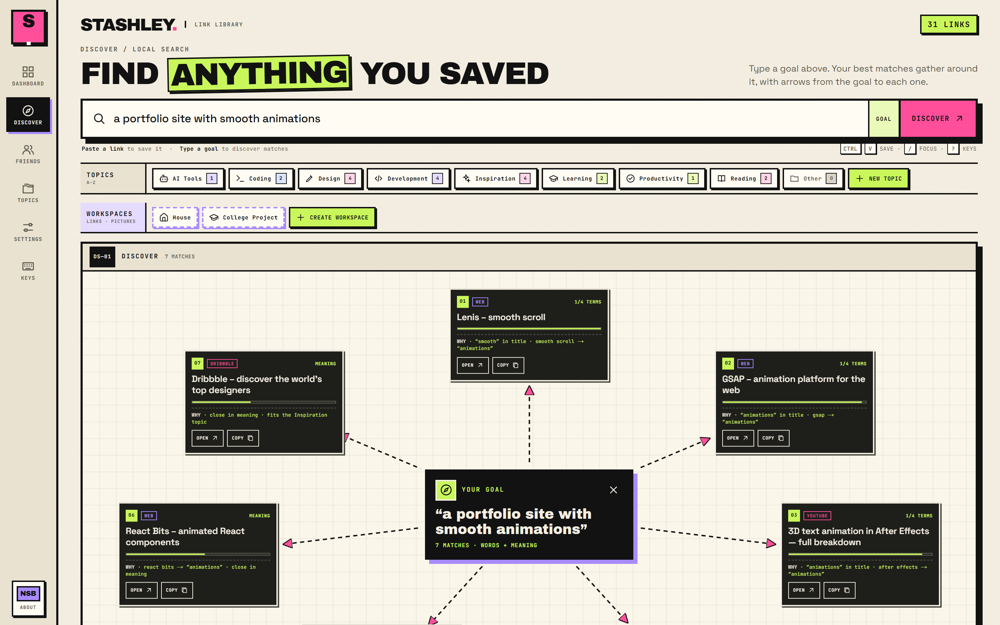
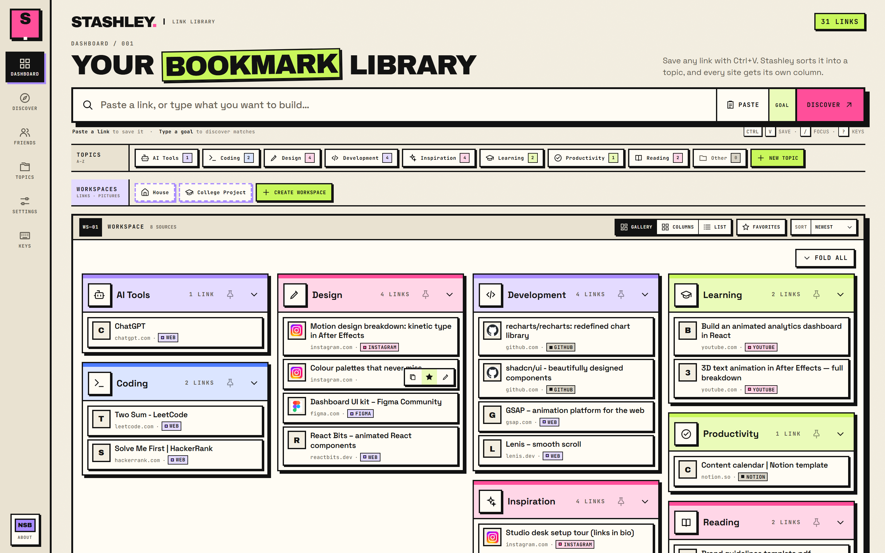
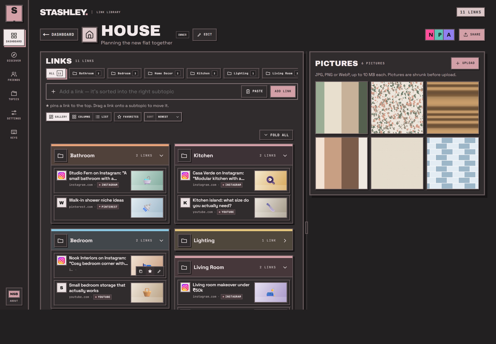

  

  <b><a href="https://stashley.vercel.app">Open Stashley</a></b> ·
  <a href="#whats-new-in-v2">What's new</a> ·
  <a href="#what-it-does">Features</a> ·
  <a href="#save-from-anywhere">Save from anywhere</a> ·
  <a href="#how-its-built">How it's built</a> ·
  <a href="#made-by">Made by</a>

  
  
  
  
  
  
  
  

  

> **My Instagram DMs were a link graveyard.** Reels I commented "LINK" on, tools friends sent, resources creators DM'd me, all buried under memes and never there when I needed them. So I built Stashley: paste a link once, and it files itself and turns up again when you're making something it's useful for.

  

## What's new in v2

**Shared workspaces.** A workspace is a space of its own, separate from your topics: a House you're planning with family, a college project, a trip. Each one has links on the left and pictures on the right.

| | |
|---|---|
| **👥 Invite people** | Share by @username or with an invite link. Everyone is an **Owner**, **Editor** or **Viewer**, and the database enforces it, not just the buttons. Member avatars sit next to **SHARE**, and changes show up live for everyone. |
| **🪄 Links sort themselves into subtopics** | Paste a bathroom reel into House and it lands in *Bathroom*. Stashley reads the title, caption and hashtags and matches them to your subtopics. Nothing fits? It goes to *Other*. |
| **✋ Drag to fix it** | Drag a link onto any subtopic to move it. Reorder subtopics and pin links to the top. |
| **🖼️ Pictures** | Upload screenshots and references in bulk. They're shrunk to WebP in your browser before upload, kept in private storage, and open in a lightbox. |
| **↔️ Your layout** | Drag the divider between links and pictures, like split screen. |
| **🔤 Tidy by default** | Topics and subtopics stay in A–Z order. Fold any block to its header, or fold them all at once. |

  

## What it does

| | |
|---|---|
| **📋 Paste and it sorts itself** | Ctrl+V anywhere, or tap **PASTE** on a phone. Stashley saves the title and preview, files the link into a topic (LeetCode into Coding, Amazon into Shopping) and makes the topic the first time it's needed. Every site gets its own column. |
| **🧭 Find it by what you're making** | Type a goal like *"a dashboard with animated charts"* and the links you saved for it gather around it, each with the reason it matched. It understands related ideas and fixes typos, and a small meaning model runs right in your browser. No AI service, nothing leaves your device. |
| **🤝 Friends** | Pick an @username, send friend requests Discord-style, choose which topics friends can see, and add their links to your own library. Requests arrive live, with a badge. |
| **📌 Pin what matters** | Pin topics to the front of the topic bar and the top of the gallery. |
| **🗂️ Three ways to look at it** | A masonry gallery of your topics, columns by site, or an inbox-style list. |
| **🎨 Calm by design** | Classic neo-brutalism plus six softer colour themes, all checked for readable contrast. There's a guided tour for new users, and small UI sounds you can switch off. |

<table>
  <tr>
    <td width="50%">
<b>Discover:</b> matches gather around your goal
</td>
    <td width="50%">
<b>Gallery:</b> every topic at a glance
</td>
  </tr>
  <tr>
    <td colspan="2">
<b>Midnight Rose:</b> one of six calmer themes
</td>
  </tr>
</table>

## Save from anywhere

| Where | How |
|---|---|
| **Android** | Install Stashley from the browser, then share any link to it straight from Instagram, YouTube or Chrome. |
| **iPhone** | An Apple Shortcut sends the link from the share sheet. |
| **Laptop** | A one-click bookmarks-bar button saves the page you're on. |

## How it's built

- **Next.js 16** (App Router) and **React 19** in **TypeScript**, with hand-written CSS: a neo-brutalist design system whose semantic colour tokens sit behind every theme.
- **Supabase** handles sign-in (Google, GitHub, email links) and Postgres.
  - Row-level security keeps every user to their own rows.
  - Friends only read through functions that check the friendship and return public fields (a name, never an email).
  - Realtime pushes friend requests and workspace changes as they happen.
  - Workspace roles are checked by the database itself: Postgres policies and security-definer functions, covered by 81 security tests.
- **Supabase Storage** keeps workspace pictures in a private bucket, served through short-lived signed links.
- **Local-first saves.** The library works instantly in the browser and syncs to the cloud in the background.
- **Link previews** are fetched on the server with SSRF protection:
  - private and internal addresses are blocked when the name is resolved;
  - each redirect is checked;
  - responses are capped in size and time.
- **Installable PWA** with an Android share target, an offline fallback page and app shortcuts. Deployed on **Vercel**.

## Status

**v2 is live and free.** The source code is private; this repo is the showcase. Ideas and bug reports are welcome: [open an issue](https://github.com/NSBforever/stashley-showcase/issues) or message me.

## Made by

**Sai Baba Nagi Reddy (NSB)**: [LinkedIn](https://www.linkedin.com/in/sai-baba-nagi-reddy-02257836a/) · [Instagram](https://www.instagram.com/nsbforever_7/) · [GitHub](https://github.com/NSBforever)

Don't just save it. <b>Stashley it.</b>

