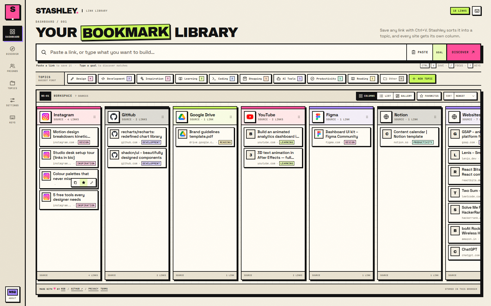
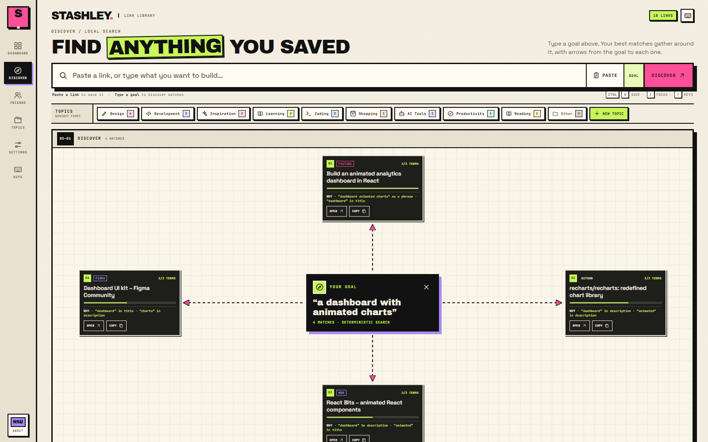
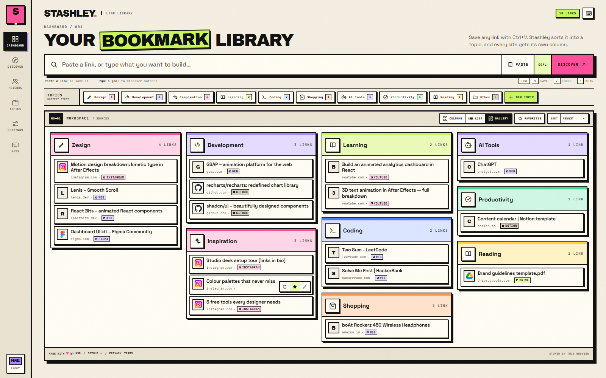
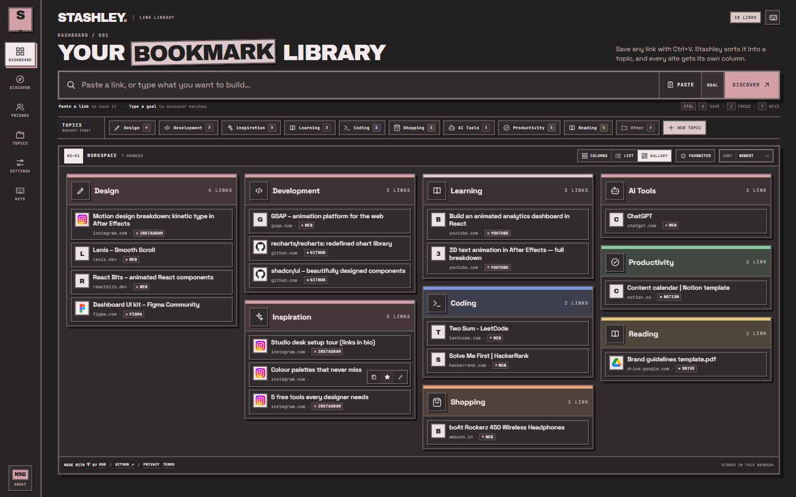

# Stashley — your bookmark library

**My Instagram DMs were a link graveyard.** Reels I asked for, tools friends sent, "comment LINK and I'll DM you" resources — all buried under memes, never there when I needed them. So I built Stashley.

**Try it free → [stashley.vercel.app](https://stashley.vercel.app)**

## What it does

- **Paste and it sorts itself.** Ctrl+V anywhere (or the PASTE button on a phone) saves a link with its title and preview. Stashley files it into a topic on its own — LeetCode into Coding, Amazon into Shopping — creating the topic the first time it's needed. Every site gets its own column.
- **Find it by what you're making.** Type a goal like *"a dashboard with animated charts"* and the links you saved for it gather around it, each with the reason it matched. No AI service: the ranking is deterministic and runs in your browser.
- **Friends.** Pick an @username, send friend requests Discord-style, choose which topics friends can see, and add their links to your own library. Requests show up live with a badge.
- **Three ways to look at it.** Columns by site, an inbox-style list, or a masonry gallery of your topics.
- **Save from anywhere.** Install it on Android and share links straight from Instagram; an Apple Shortcut does the same on iPhone; a bookmarks-bar button on laptops.
- **Calm by design.** Classic plus six softer colour themes, all checked for readable contrast, a guided tour for new users, and small feel-good sounds you can switch off.

## How it's built

- **Next.js 16** (App Router) and **React 19** in **TypeScript**, with hand-written CSS — a neo-brutalist design system with semantic colour tokens behind every theme.
- **Supabase** for sign-in (Google, GitHub, email links) and Postgres. Row-level security keeps every user to their own rows; friends only ever read through functions that check the friendship and return public fields (a name, never an email). Realtime pushes friend requests as they happen.
- **Link previews** fetched server-side with SSRF protection: private and internal addresses are blocked at DNS-resolution time, redirects are checked hop by hop, and responses are size- and time-limited.
- **Installable PWA** with an Android share target, an offline fallback page and app shortcuts.
- Deployed on **Vercel**.

## Status

**v1** is live and free. The source code is private; this repo is the showcase. Feedback and ideas are very welcome — open an issue here or message me.

## Made by

**Sai Baba Nagi Reddy (NSB)** — [LinkedIn](https://www.linkedin.com/in/sai-baba-nagi-reddy-02257836a/) · [Instagram](https://www.instagram.com/nsbforever_7/) · [GitHub](https://github.com/NSBforever)
